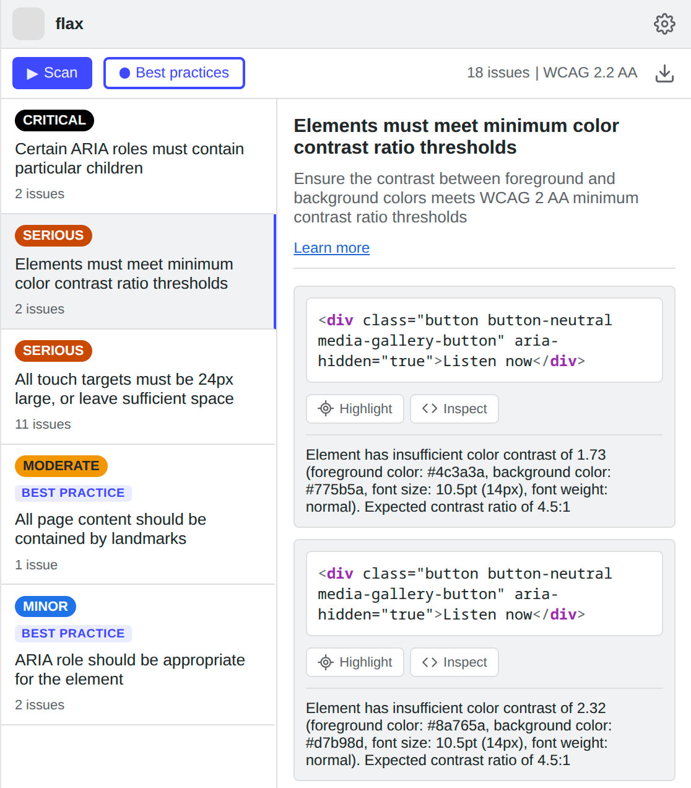

# flax

A deshittified, debloated, streamlined Axe DevTools alternative. It runs `axe-core`, then gives you the results. That's it.

  

## Philosophy
- **Simple UI:** Everything in its right place. Two-column layout, mute colors, dark/light theme.
- **Minimal features:** No AI bloat. No required (or optional) login. No guided tests. No little golden locks everywhere.
- **Expert-friendly:** When you see the issue, you already know what causes it and how to fix it.

## Installation
### From your browser's extension store

  
  
  
  

### From source (Chromium-based)
1. Clone this repository.
2. Open Chrome/Brave/Edge/Chromium and navigate to `chrome://extensions/`, `brave://extensions/` or `edge://extensions/`.
3. Enable **Developer mode** (top right).
4. Click **Load unpacked** and select the `src/` directory.

## Disclaimer
This project is independently developed and is not affiliated with, sponsored by, or endorsed by Deque Systems.

## Disclosure
The code of this extension was mosty written by AI, though I personally reviewed every single line (because of course it was not accessible). The UI/UX, the name, the logo and this readme are all human-generated.

## License
This project is licensed under the Apache License, Version 2.0 (Apache-2.0). See the [LICENSE](https://github.com/calanoix/flax/blob/main/LICENSE) file for details.